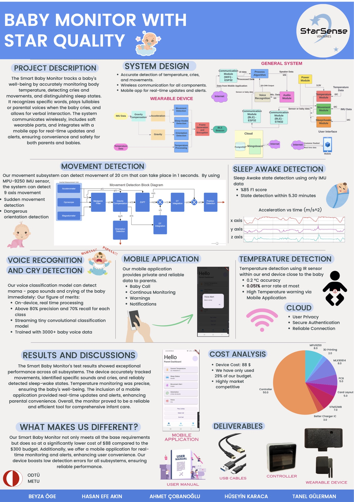

## The monitor

*Baby Monitor with Star Quality* was built by the team *StarSense Ventures* for the METU Electrical and Electronics
Engineering capstone design course (EE493–494, 2023–24). It tracks a baby's temperature, movement, sleep and voice,
and has three parts:

- a soft **wearable** with an MPU-9250 inertial sensor and an MLX90614 infrared thermometer, which detects sudden
  movement, dangerous orientations and sleep–wake state, and measures temperature;
- a **controller** (an ESP32-S3-Box) next to the cot, which listens for the baby's cries and words, plays lullabies
  or a parent's voice when the baby cries, and relays everything over Wi-Fi;
- a **mobile app**, backed by a cloud service, for live readings, alerts and calling the baby.

The prototype cost about \$88 per unit, against a course budget of \$300.

<figure class="pg-fig" markdown>
  
  <figcaption>The project poster (click for the PDF).</figcaption>
</figure>

## The voice subsystem

My part was the machine learning: the voice subsystem, and prototyping sleep–wake detection from the wearable's
inertial sensor with classic actigraphy scoring rules.

The controller had to recognise, on the device and in real time, a child calling *mama* or *papa* and a baby
crying. Public keyword-spotting datasets contain adults saying commands, so the first problem was data. I wrote a
pipeline that finds young children's *mama*, *papa* and *dada* in [CHILDES](https://talkbank.org/childes/)
transcripts and cuts them from the recordings, and screened and repaired the clips by ear. For training, the
project also used cry recordings, speech and noise for the "unknown" and "silence" classes, and some additional
*mama* and *papa* recordings, which for various reasons cannot be shared.

The models followed the TinyML keyword-spotting literature: first a small depthwise-separable CNN (DS-CNN), then
streaming models from TensorFlow's micro speech example, quantised to 8-bit integers to run with TensorFlow Lite
for Microcontrollers. The final version ran two models of under 20 kB each, one for cry detection and one for
*mama* and *papa*. The poster reports above 80% precision and 70% recall for each class. Those numbers come from
random splits of the clips, so the same child, and sometimes the same recording, appeared in both training and
test data, which makes them optimistic.

## The dataset

The children's clips, traced back to their source recordings and given splits that never share a child, are
released as **[MaPaDa](https://hkaraca.com/mapada/)**: 1,424 clips of 49 children saying *mama*, *papa* and *dada*,
from 16 CHILDES and PhonBank corpora.

## Team

Hasan Efe Akın, Ahmet Çobanoğlu, Tanel Gülerman, Hüseyin Karaca and Beyza Öge, advised by Ahmet Cemal Durgun.
